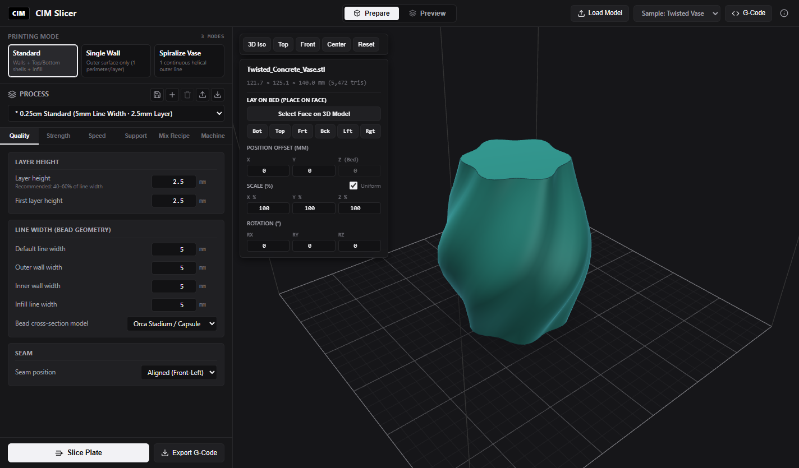
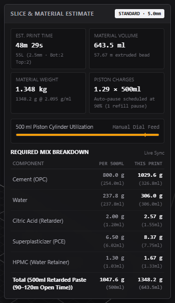
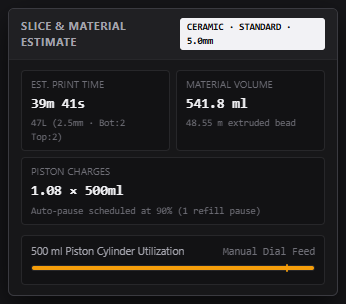
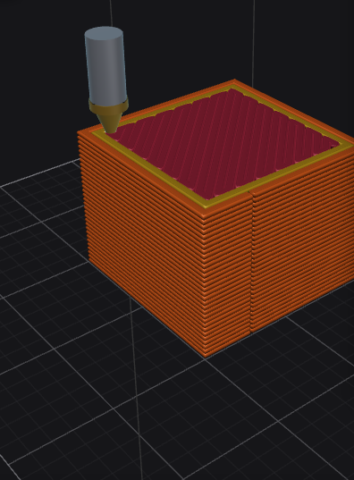

# CIM Slicer 0.4.0 - Jihu Studio

An open-source desktop 3D slicer built with Electron for **concrete and ceramic paste additive manufacturing**.



## Key Features

- **Dual Material Modes (Concrete & Ceramic)**
  - **Concrete Mode**: Absolute-volume mix recipe manager (`Cement`, `Water`, `Citric Acid`, `Superplasticizer`, `HPMC`, or custom components) with per-cylinder and per-print batch weights, wet density, W/C ratio, and optional feed-tube dead-volume accounting.
  - **Ceramic Mode**: Streamlined workflow for clay/ceramic pastes where batch density varies — configure piston cylinder capacity and get time, volume, and piston utilization estimates without mix weight assumptions.
- **Constant-Speed Volumetric Extrusion**: Uniform print speed across walls and infill with volumetric E-axis extrusion derived directly from **Line Width** and **Layer Height**.
- **90% Piston Auto-Pause**: Automatically schedules refill pause points before layers where cumulative extrusion reaches 90% of the configured piston cylinder capacity.
- **Printing Modes & Toolpath Engine**:
  - **Standard** (walls + top/bottom shells + 1D CSG infill), **Single Wall**, and **Spiralize Vase** modes
  - **Medial Thin-Wall** centerline generation and **Adaptive Hollow Support** with manual/auto pause-layer support
- **3D Prepare & Preview Workspaces**:
  - Load `.stl`, `.obj`, and `.3mf` models (file picker or drag-and-drop) with interactive translation, scaling, rotation, and lay-on-bed tools
  - Layer-by-layer and move-by-move nozzle simulation playback with G-Code inspection and export

### Feature Previews

#### Concrete Mode — Mix Recipe, Batch Breakdown & 90% Piston Auto-Pause


#### Ceramic Mode — Volume, Time & Piston Capacity Only


#### Volumetric 3D Bead & Toolpath Preview


## Downloads

Pre-built binaries for **Windows (x64)** and **macOS (Apple Silicon & Intel)** are available on the [Releases](https://github.com/kjihu18/CIM-Slicer/releases) page:

- **Windows**: `CIM-Slicer-0.4.0-Setup.exe` (Installer) / `CIM-Slicer-0.4.0-Portable.exe` (Portable)
- **macOS**: `CIM-Slicer-0.4.0-arm64.dmg` (Apple Silicon) / `CIM-Slicer-0.4.0-x64.dmg` (Intel)

## Getting Started

### Prerequisites
- [Node.js](https://nodejs.org/) (v18+ recommended)

### Run in Development
```bash
npm install
npm start
```

### Build Executables
```bash
# Windows: build unpacked directory, Portable (.exe), and Setup installer (.exe)
npm run dist

# Or build individual Windows targets:
npm run pack           # Unpacked app in dist/win-unpacked
npm run dist:portable  # CIM-Slicer-0.4.0-Portable.exe
npm run dist:setup     # CIM-Slicer-0.4.0-Setup.exe

# macOS (run on macOS):
npx electron-builder --mac dmg
```

## Quick Workflow

1. **Prepare**: Load an `.stl`, `.obj`, or `.3mf` model (or select a sample model) and position/scale/rotate it on the print bed.
2. **Configure**: Adjust **Line Width**, **Layer Height**, **Print Speed**, and **Printer Volume**, then choose **Concrete** or **Ceramic** in the **Mix Recipe** tab.
3. **Slice Plate**: Click **Slice Plate** to generate toolpaths, inspect the 3D layer preview, and view print time and material/piston estimates.
4. **Export G-Code**: Click **Export G-Code** to save machine-ready G-code.

## Keyboard Shortcuts

| Shortcut | Action |
| :--- | :--- |
| `Ctrl + 1` / `Ctrl + 2` | Switch between **Prepare** and **Preview** workspaces |
| `Space` | Play / Pause nozzle path simulation |
| `←` / `→` | Step back / forward 1 toolpath move |

## Project Structure

- `main.js` — Electron main process, window lifecycle, security policies, and local JSON storage IPC
- `preload.js` — Sandboxed `contextBridge` API (`cimDesktopBridge`)
- `index.html` / `styles.css` — Application layout and dark UI styling
- `app.js` — UI state management, preset/recipe persistence, and slicing orchestration
- `slicer-engine.js` — Mesh slicing, medial thin-wall, CSG infill, support generation, mix metrics, and G-Code generator
- `viewport3d.js` — Interactive 3D WebGL/canvas viewport and toolpath renderer

## License

MIT License — Copyright (c) 2026 Jihu Studio. See [LICENSE](LICENSE) for details.
